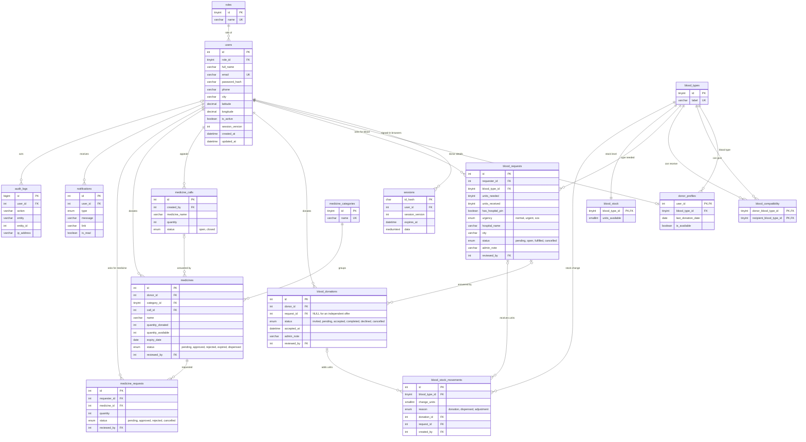

# LifeLink entity-relationship diagram

16 tables, 27 foreign keys, 13 check constraints. Open this file in VS Code's Markdown preview or on GitHub to see the diagram.
The `reviewed_by` and `created_by` links to `users` (the admin who made a decision) are left out of the picture to keep it readable; they are in `schema.sql`.

